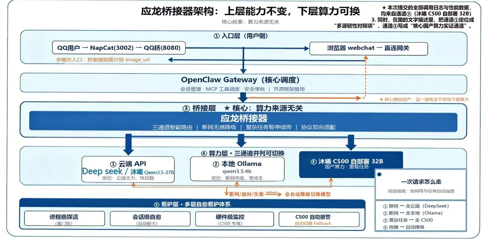

# 架构与五层结构

> 本文是申报书「架构」章与 PPT 架构页的**文字底本**。
> 图内主标题：`应龙桥接器架构：上层能力不变，下层算力可换`
> 图内副标题（核心叙事）：`核心叙事：算力来源无关`
> **状态（2026-10-13 更新）：✅ 成图已就位** ——
> [`../assets/architecture/应龙桥接器架构_五层三通道_成图.png`](../assets/architecture/应龙桥接器架构_五层三通道_成图.png)
> （1920×979 PNG，879 KB）。**本文是该图的逐层文字对应件**：图里的每一层、每一句批注，本文都有对应段落。



---

## 一、一句话核心叙事

> **上层能力不变，下层算力可换。**

含义：无论推理算力来自云端 API、本机 Ollama，还是国产 GPU 上的自部署大模型，
**上层 Agent 的能力与工作流完全不变**。这让系统既满足日常运行的稳定性要求，
也能在国产算力环境中独立运行。

**核心原创资产 = 第 ② + ③ 两层合起来** —— 即那层「**完全不动下层算力**」的桥接 / 调度层
（应龙桥接器 + OpenClaw Gateway 调度）。

---

## 二、五层结构（自上而下 · 即材料的固定叙述顺序）

### ① 入口层（用户侧）

| 分支 | 链路 |
|---|---|
| 左 | `QQ 用户 → NapCat(3002) → QQ 桥(8080)` |
| 右 | `浏览器 webchat → 直连网关` |

底部注：**多模态入口 —— 桥里提取图片转 `image_url`**。
（实现：[`../src/entry/qq_multimodal_gateway.py`](../src/entry/qq_multimodal_gateway.py)）

工程护栏：单图 ≤ 32 MB、请求体 ≤ 48 MB、单条消息最多 8 张图、取图失败**不崩**
（保留文字继续，并把原因回给用户）；普通用户发图明确回「暂不支持」。

### ② OpenClaw Gateway（核心调度）

职责：`会话管理 · MCP 工具调度 · 安全审批 ｜ 开源框架复用`

> ★ 批注：**核心原创资产 —— 这一层完全不动下层算力**。

关键工程点：
- Gateway **永远只调 Bridge**，不直连任何模型后端；
- 为什么必须这样：Gateway 原生 fallback **只捕获 HTTP 层错误**（4xx/5xx/超时），
  **网络层异常**（`ECONNREFUSED` / `ENOTFOUND`）会直接抛给前端、**不进重试链** ——
  所以「按网络状态选后端」这件事只能落在桥接层。
- 上下文压缩（compaction）走增量摘要；两级水位与解卡由看护层兜底。

### ③ 桥接层　★ 核心：算力来源无关

组件名：**应龙桥接器**（[`../src/bridge/yinglo_bridge.py`](../src/bridge/yinglo_bridge.py)）

能力（图内原文四句）：

| 能力 | 说明 |
|---|---|
| **三通道智能路由** | 按网络状态 + 任务复杂度在三个后端之间选路 |
| **断网无感降级** | 网络层异常也能降级（Gateway 做不到的那部分） |
| **复杂任务暂停续传** | 断网时的复杂任务保存现场，网络恢复后断点续传 |
| **协议双向适配** | OpenAI ⇄ Ollama ⇄ 沐曦，工具能力按后端能力裁剪 |

补充能力：网络探测（1 秒结果缓存 + 3 秒 TCP 超时）、上下文超限**前置拦截**、
无状态裁剪、语言绑定注入、诊断快照落盘。

### ④ 算力层 · 三通道并列可切换

| 通道 | 名称 | 定位（图内原文） |
|---|---|---|
| ① | 云端 API：`DeepSeek / 沐曦 Qwen3.5-27B` | 云端主力，快且稳 |
| ② | 本地 Ollama：`qwen3.5:4b` | 断网兜底，零成本 |
| ③ | `沐曦 C500 自部署 32B` | 国产算力，重载任务 |

橙色批注：**断网 / 超时 / 失败 → 会自动降级切换模型**。

> ⚠️ **定性口径（已冻结，写材料时逐条照做）**：
> - **通道① = 多源韧性对照**（对照组，**非主力叙事**）→ 只作架构对照项陈述，**不用于本次实证数据**；
> - **通道③ = 核心国产算力实证通道** → **本次提交的全部调用日志与性能数据，均来自通道③**；
> - ❌ 不得把三通道**平铺成「多源编排」而不区分实证来源**。

### ⑤ 看护层 · 多层自愈看护体系

| 组件 | 职责 | 实现 |
|---|---|---|
| 进程级探活（看门狗） | 端口探活；连续 3 次（≈6 min）判离线才动手 | [`../src/health/watchdog.py`](../src/health/watchdog.py) |
| 会话级自愈（自动解卡） | 写锁卡死自动解除 + 两级水位压缩（500 KB / 600 KB） | [`../src/health/gateway_unstick.py`](../src/health/gateway_unstick.py) |
| 硬件级监控（C500 专属） | 通道③ 探活、隧道漂移、忘关机提醒（零推理消耗） | 见 [02_三通道机制.md](02_三通道机制.md) §四 |
| C500 自动报警（自动切换 Fallback） | 实例失联时明确回落并告警 | 同上 |

**「死法 → 负责者」映射**（这张表本身就是很好的架构图素材）：

| 故障形态 | 负责者 | 关键参数 |
|---|---|---|
| 会话写锁卡死 | `gateway_unstick` | 轮询 20 s；两级水位 500 KB / 600 KB；误判延迟 5 s |
| QQ 掉线 / 被踢 | `watchdog`（QQ 保活） | 轮询 120 s；连续 3 次判离线；冷却 6 h |
| 看护自身死掉 | 守护链 + **OS 级原子单例守卫** | `O_CREAT\|O_EXCL`；并发实测 3 进程 → 1 True / 2 False |
| 网关进程死 | 守护链端口探活 | 探活 45 s；判 DOWN 2 轮 ≈90 s；退避上限 900 s |
| C500 失联 / 隧道漂移 / 忘关机 | 通道③ 探活兜底 | 轮询 120 s；判失联 3 轮（v1.3）；报警冷却 30 min |

> 生产实测：真杀真拉端到端自动闭环，**停机 96 s，全程无人工介入**；
> 单例守卫修复前曾出现**双 watchdog 并存约 16.4 h**（09-14 15:49 → 09-15 08:15）。

---

## 三、一次请求怎么走（图内阅读指南）

```
① 联网      → 走云端（DeepSeek / 沐曦 Qwen3.5-27B）   ← 多源韧性对照项
② 断网      → 走本地（Ollama qwen3.5:4b）              ← 零成本兜底
③ 复杂任务  → 走 C500（自部署 32B xihe-32b）           ← 实证通道
④ 故障      → 自动降级（→ ①，绝不静默降到 ④B）
```

细化判定（桥接器内部）：

```
收到请求
  ├─ 已点名 model=xihe-32b 且通道③在线 ────────────────────────▶ ③
  ├─ 网络不可达（TCP 探测 ai.gitee.com:443 失败）
  │     ├─ 任务简单（token<4000 / tools≤2 / 消息<500 字）──────▶ ②
  │     └─ 任务复杂 ──────────────────────────────────────────▶ 暂停 + 网络恢复后续传
  ├─ 联网 + 通道③在线 + (任务不适合本地 或 长上下文) ──────────▶ ③
  └─ 其余（含通道③不可达 / 超时 / 非 200）───────────────────▶ ①（并告警）
```

**三重回落**：不可达 / 超时 / 非 200 → 一律回落 ①。
**不静默原则**：通道③未启用时**明确回落云端并告警** —— **绝不静默降到本地 4B**。

---

## 四、可迁移性（架构与算力来源解耦的证据）

| 迁移维度 | 需要改什么 |
|---|---|
| 换推理引擎（vLLM → 其它 OpenAI 兼容引擎） | **只改端点配置**，桥接器代码零改动 |
| 换硬件（C500 → 本地 B70 / 其它国产卡） | 推理引擎不变、OpenAI 兼容接口（`:8000/v1`）不变、**桥接器路由只改一行**；**唯一变的是计费模式（¥2.5/h → 电费）** |
| 新增用途仓 | 从主源再镜像一份新仓（流程模板化，见 [08_仓库拓扑与落地形态.md](08_仓库拓扑与落地形态.md)） |

> 这正是「算力来源无关」从**叙事**变成**可操作工程事实**的地方。

---

## 五、待补（缺口登记）

| # | 缺口 | 谁来做 | 说明 |
|---|---|---|---|
| ~~N1~~ | ~~**架构图成图**~~ | — | ✅ **2026-10-13 已补**：`assets/architecture/应龙桥接器架构_五层三通道_成图.png`（舰长提供的成图入库，与本文口径逐条一致） |
| N2 | 申报书正文 | 舰长 | 本文只作**架构章文字底本** |
| N3 | 双报告（性能 / 成本） | 舰长 | 成本报告缺首 token 延迟 / 吞吐 / 2-4-8 并发三项支撑 |

> **成图的 2 处待确认小瑕疵（不影响入库，登记备查）**：
> ① 图内右上角说明文字从「**3.** 同时，在图的文字描述里……」起编号，前面两行无编号 —— 像是从一份编号清单里截取的片段；
> ② 图内三通道第 ① 项写作 `Deep seek`（应为 `DeepSeek`，中间多一个空格）。
> 二者均为**排版层面**的措辞问题，**不涉及口径错误**；如需修图，属舰长的成图原件处置。
